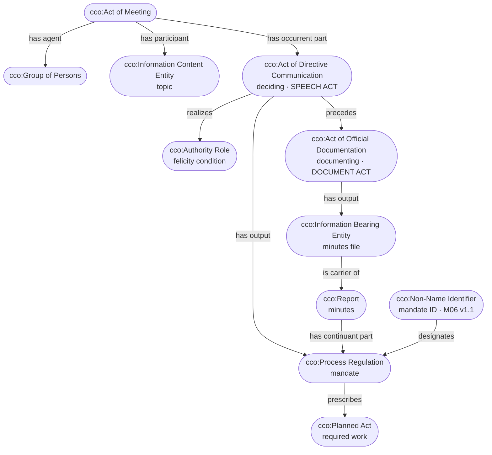

# Steps 2 and 5 revisited: deciding is a speech act, documenting is a document act

**Course material applied:** Barry Smith, *Document Acts* (week 03 reading), especially p. 6 (the history of "to record"), pp. 9–10 (felicity conditions; documents as prosthetic memory) and p. 10 (knowledge by comparison through shared identifiers).

## What was wrong in v1

The workshop pattern (slide 10, v1) had one node doing two jobs: `cco:Act of Directive Communication` "deciding", with the mandate as its output and nothing about the minutes. The BPMN (slide 6) already had two separate tasks, **Make Decision** and **Document Decisions**, but the pattern merged them.

*Document Acts* explains why they have to stay separate.

## Three points from the paper, applied

| Paper | Applied to meetings and mandates |
|---|---|
| **p. 6.** In 13th-century England, "to record" shifted from *bearing oral witness* to *producing a document* | A chair's decision used to live in the memory of the people in the room. The minutes are the shift from witness to document |
| **pp. 9–10.** Speech acts create obligations, but in an extended society memory can't carry them. Documents "support enduring and re-usable deontic powers". Both speech and document acts have **felicity conditions**: the author must have the authority, the right intentions and the right context | **Make Decision** is the speech act. It creates the obligation, and it only succeeds if the chair bears an authority role. **Document Decisions** is the document act. It gives that obligation a carrier that outlasts the meeting and can reach people who weren't there |
| **p. 10.** Knowledge by comparison: **alphanumeric identifiers** create "virtual attachment between documents via cross-referencing" (tracking numbers, VINs) | A mandate ID and version, such as **M06 v1.1**, works like a tracking number. The same ID in the minutes, a follow-up letter and a tracker links all three to one mandate. No file has to point to another file |

## What changes in the pattern

| Element | v1 | v2 | Term (verified) |
|---|---|---|---|
| Deciding (BPMN *Make Decision*) | the only act | **speech act**: realizes the authority role, outputs the mandate | `cco:Act of Directive Communication` (cco:ont00000133) · `cco:Authority Role` (cco:ont00000187) |
| Documenting (BPMN *Document Decisions*) | missing | **document act**: outputs the minutes | `cco:Act of Official Documentation` (cco:ont00000438): *"An Act of Declarative Communication in which an Agent records some information for official use by another Agent"* · aligned to `iao:documenting` (IAO_0000572) |
| Minutes | missing | a report that **has the mandate as a continuant part** | `cco:Report` (cco:ont00002043) |
| Minutes file | missing | the carrier that makes the mandate endure | `cco:Information Bearing Entity` · `bfo:is carrier of` |
| Mandate ID (M06 v1.1) | missing | **designates** the mandate, and is reused across documents | `cco:Non-Name Identifier` (cco:ont00000649) · `cco:designates` |

### Why `Act of Official Documentation`

It's what Smith calls a document act, and CCO already has it. It's a **declarative** act: recording the decision "for official use by another Agent" changes what other agents can do with it. The responsible person can now be held to it, and a letter can cite it. My own Step 5 workshop used this term for *Document Decisions*. v1 of the Mermaid just dropped it.

The division of labour:
- **The speech act** (directive) creates the obligation.
- **The document act** (declarative) makes the obligation official and lasting.
- I considered `Act of Reporting` (representative) and rejected it. The minutes aren't just a true account. Once recorded, they're the version of the decision others are bound by.

## Revised workshop pattern (slide 10, v2)

**Lint** (Design Pattern Assistant linter, on `pattern-v2-triples.tsv`): **PASS, 0 errors, 3 warnings.**
- *has output → Process Regulation (a GDC):* kept on purpose. CCO's own definition of Process Regulation says it is "the output of" an act that realizes an authority role (same decision as D9 in Step 5).
- *topic and identifier never concretized:* both end the pattern. Their carriers (the deck, the minutes file) are already shown.

## Slide 6 (BPMN) annotations

The BPMN itself doesn't change. Slide 6 now labels:
- **Make Decision** → *speech act: creates the obligation (felicity condition: authority)*
- **Document Decisions** → *document act: makes the obligation endure and travel*

## Open questions this raises

1. When the board formally approves the minutes at the next meeting, is that a second `Act of Official Documentation`? If so, the mandate's standing depends on three acts: decide, record, approve.
2. When the same mandate shows up in a follow-up letter, is the letter a second document act about the same mandate, or a new directive (M06 v1.1)? The identifier says it's the same subject. The pattern currently treats a version bump as a **new** process regulation that the earlier one precedes.
