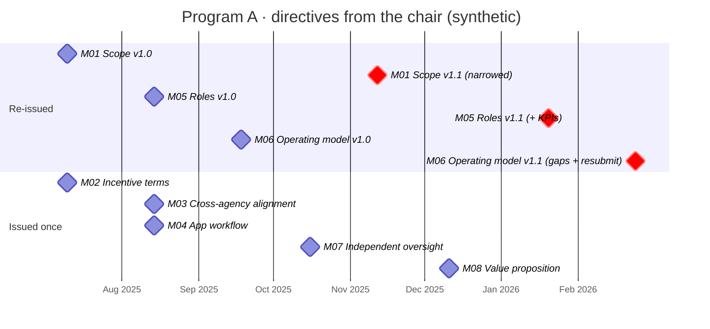

# File Engineering, aligned to IAO

**Course material applied:** Smith et al., *IAO-Intel: An Ontology of Information Artifacts in the Intelligence Domain* (week 03), and the Information Artifact Ontology (IAO, `http://purl.obolibrary.org/obo/iao.owl`, labels and definitions checked against the release file on 2026-10-17).

## What "File Engineering" is

File Engineering is the method behind this pattern. An executive office runs on **priority files**. A file is the full dossier for one programme: its meetings, minutes, letters and the directives the chair has issued. File Engineering turns each file into machine-readable artifacts in four layers:

1. Start with the executive's **priorities**.
2. Map each **priority file** to those priorities.
3. Map the file down to **programme level**.
4. Knowledge-engineer the programme:
   - expose its nodes (meetings, mandates, people)
   - build direct links and a taxonomy
   - build relationships inside the file, using a **timeline**

The pattern on these slides models step 4 for one file. (The real files are internal and are not published here. The timeline below is synthetic.)

## Decision: CCO is the import; IAO is an alignment

The pattern is built on BFO + CCO. IAO covers the same ground (information content entities, documents) and is a separate artifact, so importing both would give two competing classes for "document". So:

- **CCO is imported.** It's the ontology used in the intelligence domain, and it has the deontic terms the pattern depends on (`Process Regulation`, `Authority Role`).
- **IAO is aligned, not imported.** Each File Engineering class gets a `skos:closeMatch` or `skos:exactMatch` to its IAO counterpart. Someone using IAO-based tooling can still find the data. This follows IAO-Intel's own method, which populates downward from IAO rather than inventing a parallel hierarchy.

## Alignment table

| File Engineering element | Arabic source label | New subclass (downward population) | IAO class | CCO class (used) | Match |
|---|---|---|---|---|---|
| Priority file (the dossier) | ملف | `Priority File` | `document` IAO_0000310: *"A collection of information content entities intended to be understood together as a whole"* | `Information Content Entity` (no CCO class for a document collection) | close |
| Meeting presentation | عرض | `Meeting Presentation` | `document` IAO_0000310 | `Document Content Entity` cco:ont00002039 | close |
| Minutes | محضر | `Meeting Minutes` | `report` IAO_0000088: *"…the output of a documenting process…"* | `Report` cco:ont00002043 | **exact** |
| Official letter | خطاب | `Official Letter` | `document` IAO_0000310 | `Document Content Entity` cco:ont00002039 | close |
| Directive / mandate | توجيه | `Mandate` | `directive information entity` IAO_0000033 | `Process Regulation` cco:ont00001324 | close: IAO has no authority condition |
| Recording the decision | توثيق | — | `documenting` IAO_0000572: *"A planned process in which a document is created or added to…"* | `Act of Official Documentation` cco:ont00000438 | close: CCO adds "for official use" |
| Mandate ID + version (M06 v1.1) | — | — | `identifier` IAO_0020000 | `Non-Name Identifier` cco:ont00000649 | close |
| Executive priority | أولوية | — | `objective specification` IAO_0000005 | `Objective` cco:ont00000476 | close |
| People (chair, owner) | — | — | *out of IAO's scope*: IAO covers information only | `Person` | — |

**Version numbers.** IAO's `version number` (IAO_0000129) is defined for *manufactured products*, so it doesn't fit. In this pattern each version (v1.0, v1.1) is a distinct mandate, and the version is part of its identifier string. Recurrence is modelled with `precedes` between mandates, not with a version attribute.

## IAO-Intel as precedent

IAO-Intel builds its types by **downward population from doctrinal document typologies**. Its Table 1 sets *Intelligence Report* under IAO *Report*, and the FM 6-99.2 report types (INTREP, INTSUM, OPSUM, …) follow the same move. File Engineering does the same for an executive office's own typology: *Meeting Minutes* under *report*, *Official Letter* and *Meeting Presentation* under *document*, *Mandate* under *directive information entity*.

IAO-Intel also argues for building coverage **incrementally, as analysts work through new source types**. That's the justification for engineering one file at a time.

## Synthetic timeline (stands in for the real file)

One fictional programme, eight directives. Three were re-issued (v1.1), which is the signal the pattern exists to catch.

