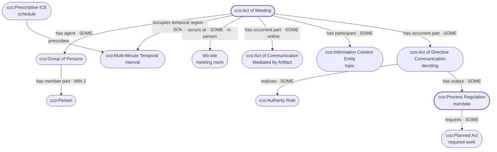
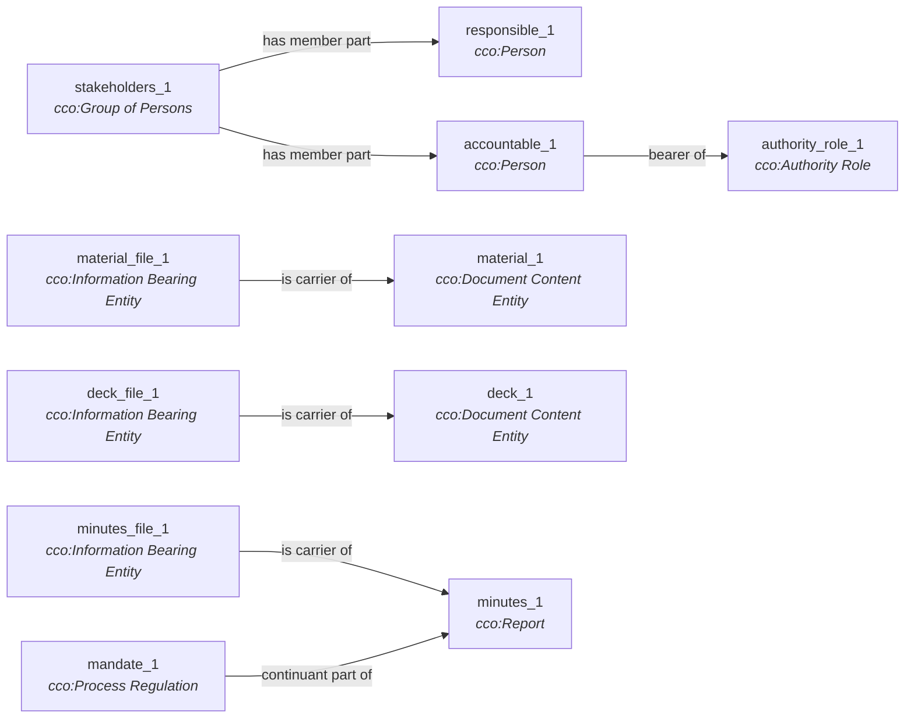
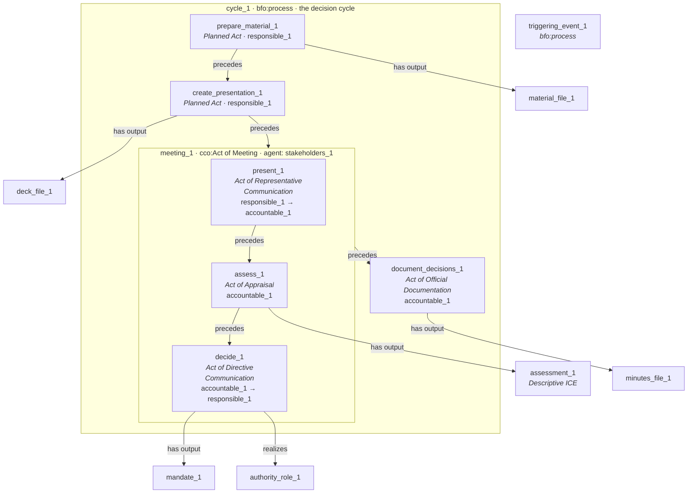
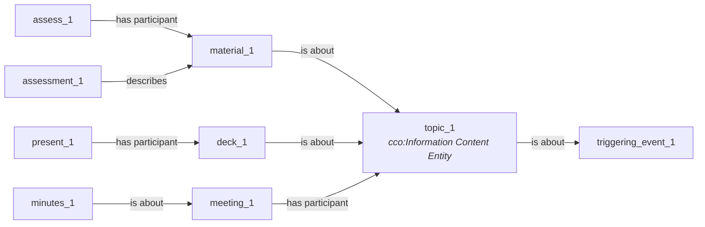
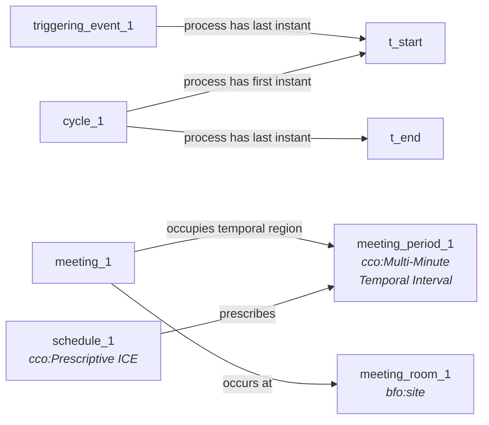
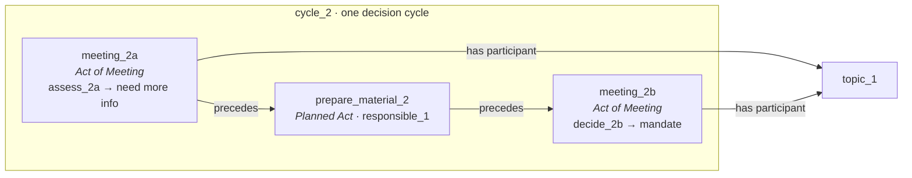
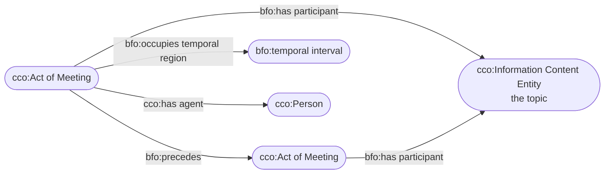

# Exercise 3: Meeting · Step 3: Workshop

**Built from:** `Meeting.bpmn` (which takes precedence) and your definition · assumptions A1–A7 from Step 1 (no pauses)
**Size:** 63 triples, 33 nodes · **Lint:** PASS, 0 errors · **New terms:** none
**Terms and reasons:** `step2.md` · **Machine-readable:** `triples.tsv`

> **How to read:** oval = class · rectangle = instance, with its type in italics · every type is a verified `bfo:` or `cco:` term
>
> **How to respond:** override an assumption (`A2: …`) or reply to a decision (`D4: challenge — …`)

---

## Panel A: your definition, clause by clause (class level)



| Your definition says | The pattern says |
|---|---|
| "a type of **human gathering**" | `Act of Meeting`: "two or more Persons assemble for some common purpose". Its agent is a `Group of Persons` with **at least 2** persons |
| "**(online / in person)**" | it happens *either* in some room (`occurs at` a site) *or* has parts where technology carries the communication (`Act of Communication Mediated by Artifact`) |
| "for a **determined period of time**" | it takes up a `Multi-Minute Temporal Interval` that a schedule **prescribes** in advance |
| "to **address a topic(s)**" | some topic (information) takes part in it: one or more |
| "and **make decisions (mandates)**" | part of it is an `Act of Directive Communication` that uses an `Authority Role` and outputs a `Process Regulation` that **requires** further acts |

---

## Panel B: one run of the BPMN (a meeting that decides)

### B1: Who and what



The mandate is **part of** the minutes, not the same thing as them, which is your mandate pattern's point. The same mandate can also be part of a follow-up email or next month's slides.

### B2: What happens



**Preparation happens before the meeting and documenting after it, but both are inside the decision cycle** (A1). The mandate's recipient is the responsible person, the one who has to act on it.

### B3: What it's all about



A process can't be *about* anything in BFO; only information can. So "the meeting addresses the topic" is stated as **the topic taking part in the meeting** (D3). The material and slides are about the topic, and the minutes are about the meeting.

### B4: When and where



`occupies temporal region` gives the meeting its time; `occurs at` gives it its room. These are two different relations, and mixing them up is exactly the error in your mandate pattern (see below).

### B5: The loop: one decision, two meetings



**The same topic takes part in two meetings, one after the other.** That's the legal way to say "we had to meet twice about this". It's also the fix for the recurrence arrow in your mandate pattern.

---

## Your Final Presentation mandate pattern, re-checked

Your `01-cdp-mandate-pattern.md` Panel A is the "make decisions (mandates)" half of this exercise, so I transcribed it (`mandate-pattern-check.tsv`) and ran it through the linter:

```
triples: 15   nodes: 13
  ERROR  L9: [4] 'occurs at' declares range 'site' but 'temporal interval' is a Temporal Region
  ERROR  L16: [3] 'is predecessor of' declares domain 'independent continuant' but 'Process Regulation' is a GDC
  ERROR  L16: [4] 'is predecessor of' declares range 'independent continuant' but 'Process Regulation' is a GDC
  WARN  L10: [12] 'is output of' with 'Process Regulation' (GDC) - ...
  WARN  [11] 'meeting' is typed 'Act of Meeting', a cco:Act, but has no `has agent` - ...
  WARN  [11] 'required work' is typed 'Planned Act', a cco:Act, but has no `has agent` - ...
FAIL  3 error(s), 3 warning(s)
```

**Two things to fix before you present:**

1. **`Mtg — cco:occurs at → bfo:Temporal Interval`** → change to **`bfo:occupies temporal region`**. `occurs at` ranges over `site` (places), not times.
2. **`PR — cco:is predecessor of → PR`** (the recurrence loop, which is your analytic payload) → `is predecessor of` applies only to *independent continuants*, and a mandate is content. **Put the recurrence on the meetings instead:** `Act of Meeting — bfo:precedes → Act of Meeting`, where both meetings have the same topic as a participant (B5), and each one's directive act outputs a mandate. "Chain length ≥ 2" then becomes "the same topic was addressed in two or more meetings". That's still countable, and it's legal.

The rest is minor. `is output of` on a mandate is common CCO practice, and CCO's own `Process Regulation` definition says "output of", so you can keep it and note it. The two check-11 warnings go away if the meeting and the required work each get a `has agent`.



*The corrected pieces only. Everything else in your Panel A stands.*

---

## Decision log

| ID | Decision | Why | Alternative | What would change it |
|---|---|---|---|---|
| **D1** | The meeting = `Act of Meeting`, containing presenting, assessing and deciding; preparing and documenting sit outside it, in the cycle *(A1)* | the narrative's "gathering" is the meeting; the BPMN pool is wider | the whole pool = the meeting | the documenting happens during the meeting |
| **D2** | The loop = a new meeting on the same topic *(A2)* | preparing again implies the first meeting has ended | the loop stays inside one meeting (a pause, not a new meeting) | re-preparation happens during a break |
| **D3** | The topic = information that **takes part in** the meeting *(A3)* | processes can't be "about" things in BFO; taking part is the only link available | the mandate or minutes `is about` the topic, with the meeting linked only indirectly | — |
| **D4** | Only *Accountable* gets a role: `Authority Role` *(A4)* | deciding creates a Process Regulation, which is exactly how CCO defines authority | `*Responsible Role` / RACI role classes | you need to ask "who was responsible for topic X?" |
| **D5** | Online and in person are alternatives in Panel A; Panel B shows in person *(A5)* | both are in the narrative | two example runs | — |
| **D6** | The period = `Multi-Minute Temporal Interval` prescribed by a schedule *(A6)* | "determined" = fixed in advance | a plain temporal interval with no schedule | — |
| **D7** | The mandate = `Process Regulation`, output by the directive act and part of the minutes *(A7)* | CCO's definition and your mandate pattern | a named `*Mandate` class | you want mandates queryable by name (the same point as Exercise 2's D1) |
| **D8** | Preparing, creating and documenting output **the files**; the content is carried by them | outputs must be independent continuants (lint check 12) | output the content directly | — |
| **D9** | The assessment result and the mandate remain content outputs, despite check 12 | neither source names what carries them; CCO's own Process Regulation definition says "output of" | drop both output edges | a carrier gets named |
| **D10** | The stakeholders (a group) are the agent of the meeting | "two or more Persons assemble". CCO counts the group as an Agent by inference | each person as agent separately | — |
| **D11** | Presenting = `Act of Representative Communication` | a presenter vouches for the content's truth | `Act of Communication Mediated by Artifact` (slides are a medium) | the presenting is mainly about the medium |
| **D12** | The mandate's recipient = the responsible person | they are the one who has to act on it | the whole stakeholder group | — |

---

## Lint

```
triples: 63   nodes: 33
  WARN  L37: [12] 'has output' with 'Descriptive Information Content Entity' (GDC) - CCO defines inputs/outputs as Independent Continuants; use the carrier, or justify
  WARN  L43: [12] 'has output' with 'Process Regulation' (GDC) - CCO defines inputs/outputs as Independent Continuants; use the carrier, or justify
  WARN  [8] GDC 'Descriptive Information Content Entity' is never concretized (justify if terminal)
  WARN  [8] GDC 'Information Content Entity' is never concretized (justify if terminal)
  WARN  [8] GDC 'Prescriptive Information Content Entity' is never concretized (justify if terminal)
PASS  0 errors, 5 warning(s)
```

**Why the warnings are acceptable:** the check-12 warnings are D9. The check-8 warnings cover the topic, the assessment result and the schedule, none of which has a carrier named in your sources. **The mandate no longer triggers check 8**, because it's part of the minutes, which are carried. (Check 8 now follows parthood, a change made during this exercise.) **Check 11 is clean:** every Act, the meeting included, has an agent.

---

## Critique

**Dogmatist.** No new terms, 18 exact CCO matches.

- `Act of Meeting`'s definition matches your "human gathering" almost word for word.
- RACI's *Accountable* turns out to be exactly CCO's `Authority Role`: the role "realized by Processes which create… Process Regulations".
- The loop is stated with legal relations only: two meetings in sequence, the same topic taking part in both. That also fixes the recurrence arrow in your presentation.

**Academic.** Dropping *Responsible* as a role (D4) loses the RACI distinction. If the organisation uses RACI to answer "who was responsible for this topic?", that question now has to go through which acts each person performed, not through a role. That works, but it's indirect. A `*Responsible Role` would make it direct, at the cost of the first new term in this exercise.

**Skeptic.** The pattern treats every decision as a **mandate**, because your definition says "decisions (mandates)". But many meeting decisions direct no one: "noted", "deferred", "we'll go with option B". Those aren't `Act of Directive Communication`, and they don't produce a `Process Regulation`. The pattern is right *for your definition*, but the definition is narrower than meetings in general.

**Did the Skeptic change the pattern?** No. Your definition explicitly equates decisions with mandates, and the pattern follows it. But if you reuse this pattern for meeting records generally, the *decide* step needs a more general type, with the directive act as one kind of decision.

**Verdict.** The pattern stands. The most valuable output of this exercise is probably **the two fixes to your Final Presentation mandate pattern**, especially the recurrence arrow, since it carries the talk's main analytic claim.
